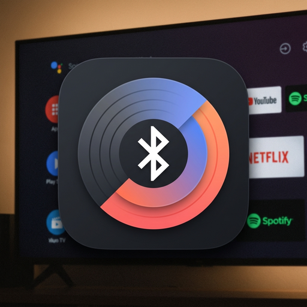
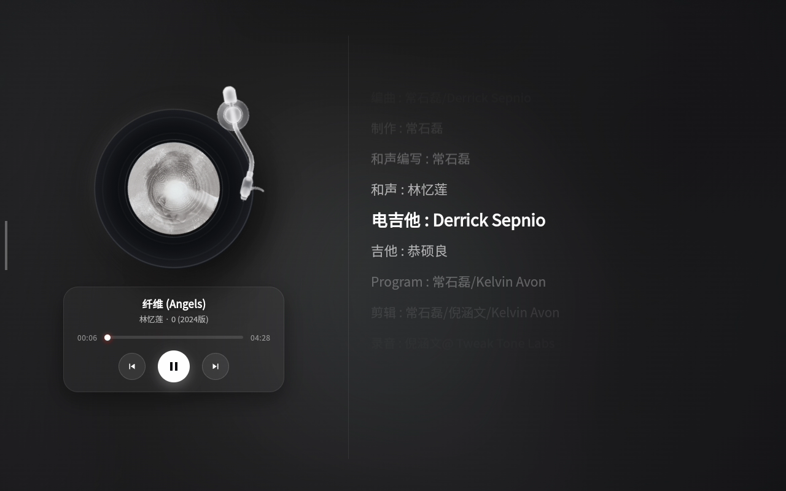
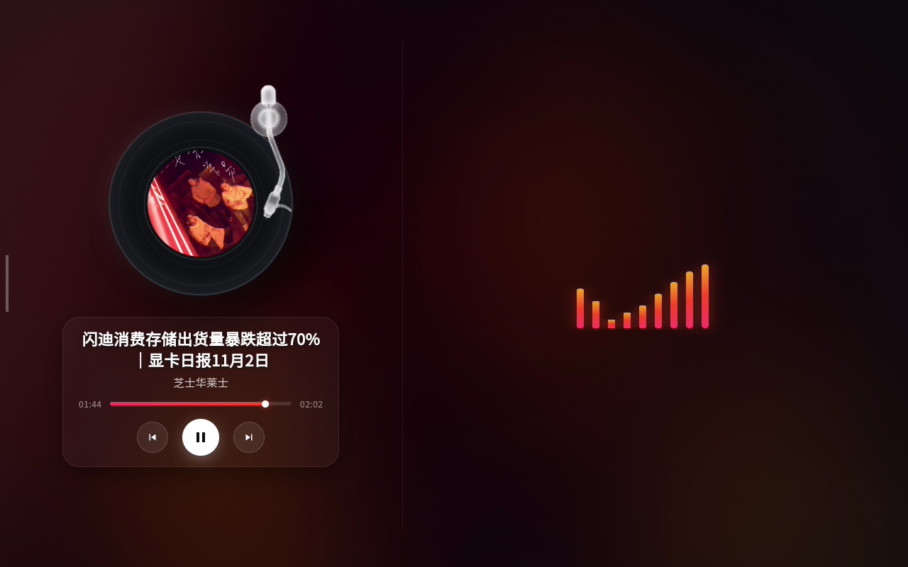

<div align="center">



# 🎵 Bluetooth Music Canvas (蓝牙音乐看板)

> **极简、高颜值的 Android 蓝牙音频大屏看板 & 桌面黑胶悬浮球**  
> 手机蓝牙连上大屏设备放歌，电视 / 车机 / 智慧屏秒变现代拟物黑胶唱机与全屏流光歌词幕布。

[-brightgreen.svg)](https://developer.android.com)
[]()
[](LICENSE)
[](BluetoothMusicCanvas.apk)

</div>

---

## 🌟 核心特性 (Features)

### 💿 1. 拟物级毛玻璃黑胶唱机与物理循迹唱针
- **现代毛玻璃极简美学**：采用高质量 3D 渲染白透磨砂毛玻璃唱针与圆形基座，通透自然。
- **真实唱针物理循迹**：根据乐曲实时播放进度，唱针从黑胶外圈导槽平滑向内圈游走；暂停时自动复位升起至外圈休眠座。
- **超清同心导槽黑胶盘**：随专辑封面动态提取并生成专属微距黑胶唱片，播放时伴随细腻物理动效平滑旋转。

### 📊 2. 真·5频段动态频谱仪（1024点真实 FFT 物理频带与静音平息）
- **1024 点采样与真实物理频宽换算**：捕获尺寸由原先的 128~256 点提升至 1024 点，依据真实采样率 $F_s$ 与频点宽度 $f_k = k \cdot F_s / N$ 计算真实物理频率，彻底分离次重低音：
  - 第 1 柱：次重低音 / 底鼓 (20Hz ~ 250Hz)
  - 第 2 柱：中低频 / 贝斯 / 大提琴 (250Hz ~ 600Hz)
  - 第 3 柱：核心中频 / 人声 / 长笛管乐 (600Hz ~ 2000Hz)
  - 第 4 柱：中高频 / 泛音明亮度 (2000Hz ~ 6000Hz)
  - 第 5 柱：高频空气感 / 镲片 (6000Hz ~ 16000Hz)
- **彻底脱钩系统音量大小**：内置自适应动态增益控制（AGC），自动跟踪频段能量分布。**无论电视音量调为 100%、5% 甚至静音，频谱波形均可全动态弹性律动**。
- **静音平滑平息与休眠基底**：无音频或播放暂停时，柱条自适应衰减归位于底座胶囊基线（scale 0.08），彻底消除静音死循环正弦波。

### 🖼️ 3. 多源官方超清封面与智能语义排版
- **多层级超清原画匹配**：原生多线程聚合检索（NetEase / Apple Music 600×600 / Kugou / QQ），无惧跨域与防盗链。
- **古典乐长曲名智能分行排版**：智能识别作品编号与乐章号（如 `K. 285: I. Allegro`），将乐章号与速度标记紧密绑定防孤立折行，保证长曲名完整优雅显示。

### 🎤 4. 6 大歌词来源自由切换 & 双层时钟权威校准 (Sub-Second Lyric Sync)
- **多歌词源一键切换**：支持「自动推荐」、「网易云音乐」、「QQ音乐」、「酷狗音乐」、「LRCLIB 全球库」、「蓝牙实时歌词流」及「全屏律动氛围」自由切换，满足小众外语歌与冷门歌曲的匹配需求。
- **双层时间窗口与自适应权威校准**：
  - 第一层（优先窗口）：在估计进度 $\pm 15$ 秒内严密匹配，杜绝相同副歌重复段落误跳回第一段；
  - 第二层（全局兜底）：当大幅 Seek 跳转或进度漂移时，自动选取时间绝对距离最近行归位。
- **健壮的多精度 LRC 解析**：完美兼容无毫秒 `[mm:ss]`、1~3 位浮点毫秒 `[mm:ss.xxx]` 与 `[offset:+/-ms]` 整体偏移补偿。
- **多代次身份隔离与局部 DOM 高亮**：引入 `PlaybackGeneration` 与 `SourceRequestId` 严格防串歌乱序；采用 $[old-4..old+4] \cup [new-4..new+4]$ 真正并集局部更新 DOM，告别全量重绘。

### 🎬 5. 智能视频音轨与正规音乐多层漏斗识别
- **强特征定视频，有专辑保音乐**：针对 B 站等应用，智能识别 UP 主及视频特征；只要包含正规专辑名，无论单曲（Single/EP）标题多长或副标题多复杂，一律强保为正规音乐。
- **底层硬件音频能量感知**：针对小红书等无 MediaSession 状态但有音频输出的短视频应用，通过底层 Audio Session 原生能量探测自动唤醒大屏“环境音/视频模式”，杜绝黑屏假死。
- **手动切源权威覆盖**：在右下角手动指定歌词来源时，自动解除视频遮罩，回归唱机面板。

### 🎈 6. 桌面迷你旋转黑胶悬浮球 (Mini Floating Vinyl Widget)
- 应用退居后台时，在桌面常驻平滑旋转的微缩黑胶悬浮球，支持全屏幕任意拖拽，记忆上次悬浮坐标，轻触即刻秒级拉起全屏看板。

### 🚀 7. 极度轻量、低配流畅模式与高能效
- **低配流畅模式（Performance Mode）**：在左上角设备详情中提供一键流畅开关，针对老旧电视盒/车机芯片禁用高消耗的 `backdrop-filter` 磨砂毛玻璃，大幅降低 GPU 图层合成开销。
- **50 首 LRU 缓存与网络合并**：内置 50 首容量上限的 LRU 内存缓存与飞行中相同网络请求合并（In-Flight Deduplication），切歌不卡顿、无内存泄漏。
- **纯原生无重型依赖**：全包体积仅 **~450KB**，基于 Android API 21+ 构建（Target API 28，针对电视大屏与车载设备深度调优），采用标准 v1 签名确保在老旧盒子与各类 Android 终端上平滑安装。

---

## 📸 实机展示 (Screenshots)

<div align="center">
  
  <p><i>（实机运行 1：音乐模式 —— 拟物毛玻璃唱机循迹 + 高清微距黑胶 + 450ms 预读平滑高亮滚动歌词）</i></p>
  <br/>
  
  <p><i>（实机运行 2：视频/环境音频模式 —— 智能音轨识别 + 延续高清封面 + 5频段 AGC 动态律动音浪）</i></p>
</div>

---

## 📦 安装与快速开始 (Quick Start)

可以直接下载本仓库根目录提供的已签名正式版本 [`BluetoothMusicCanvas.apk`](BluetoothMusicCanvas.apk)，通过 ADB 或 U 盘直接安装到您的设备。

### 1. 安装 APK
```bash
adb install -r BluetoothMusicCanvas.apk
```

### 2. 授予必要系统权限 (仅需一次)
为了实现蓝牙播放自动唤醒大屏、捕获音频频谱及后台悬浮黑胶球，需通过 ADB 或系统设置授权：

```bash
# 1. 授予媒体会话监听权限 (监听蓝牙音乐播放/暂停/元数据)
adb shell cmd notification allow_listener com.bluetoothmusiccanvas/com.bluetoothmusiccanvas.MediaMonitorService

# 2. 授予音频分析与频谱捕获权限
adb shell pm grant com.bluetoothmusiccanvas android.permission.RECORD_AUDIO

# 3. 授予悬浮窗权限 (System Alert Window)
adb shell appops set com.bluetoothmusiccanvas SYSTEM_ALERT_WINDOW allow

# 4. 授予后台运行与电池白名单 (防止电视休眠被系统杀后台)
adb shell cmd deviceidle whitelist +com.bluetoothmusiccanvas
adb shell appops set com.bluetoothmusiccanvas RUN_IN_BACKGROUND allow
```

### 3. 开始享受音乐
1. 手机与大屏设备配对连接蓝牙。
2. 在手机上打开任意流媒体软件（网易云、QQ 音乐、Apple Music、Spotify、YouTube Music 等）播放乐曲。
3. 大屏设备自动点亮并进入全屏黑胶看板！

---

## 🛠️ 自主构建工程 (Zero-Dependency Build)

本项目内置完全独立的跨平台自动化构建流水线 [`build.py`](build.py)，**无需安装数十 GB 的重型 Android Studio**，仅依赖标准 JDK（8+ / 11 / 17）与轻量 Android CLI 构建工具（AAPT2, android.jar, D8）：

```bash
# 运行极速构建流水线 (耗时通常仅 3~5 秒)
python build.py
```

构建流水线会自动查找系统 JDK，按序执行：资源编译打包 (AAPT2) ➔ Java 编译 (javac) ➔ Dalvik 字节码生成 (D8) ➔ APK 归档与签名 (jarsigner)，并在根目录输出最终的 `BluetoothMusicCanvas.apk`。

---

## 🏗️ 架构说明 (Architecture)

```text
手机 (蓝牙发送端)
       │ (Bluetooth A2DP Audio + AVRCP Controls & Metadata)
       ▼
Android 系统底层协议栈 (com.android.bluetooth)
       │
       ▼ (MediaSessionManager)
MediaMonitorService (com.bluetoothmusiccanvas.MediaMonitorService)
       │
       ├──> MetadataFetcher (Java 多线程聚合检索 NetEase / Apple Music / Kugou)
       ├──> AudioVisualizerHelper (原生 DSP FFT 频谱捕获 + AGC 自适应增益)
       ├──> WindowManager (桌面迷你旋转黑胶悬浮窗 TYPE_APPLICATION_OVERLAY)
       └──> MainActivity (硬件加速 WebView 沉浸容器)
              │
              ▼
       assets/index.html (3D黑胶唱片、毛玻璃唱针物理循迹、流光背景、逐行歌词、5频段音浪)
```

---

## 📜 项目背景 (Project Background)

本项目的早期开发基于 [天翼 C10H / 创维 SK-L1001 改造项目](https://github.com/Arrow36/tianyi-c10h-skyworth-SK-L1001-mod) 中的相关探索，现已独立为更通用、高性能的现代 Android 大屏蓝牙音乐看板开源项目。

---

## 📄 开源许可证 (License)

本项目采用 [MIT License](LICENSE) 开源。欢迎提交 PR 与 Issue！
