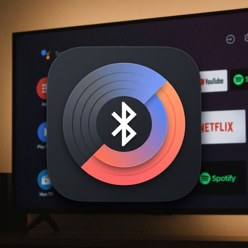
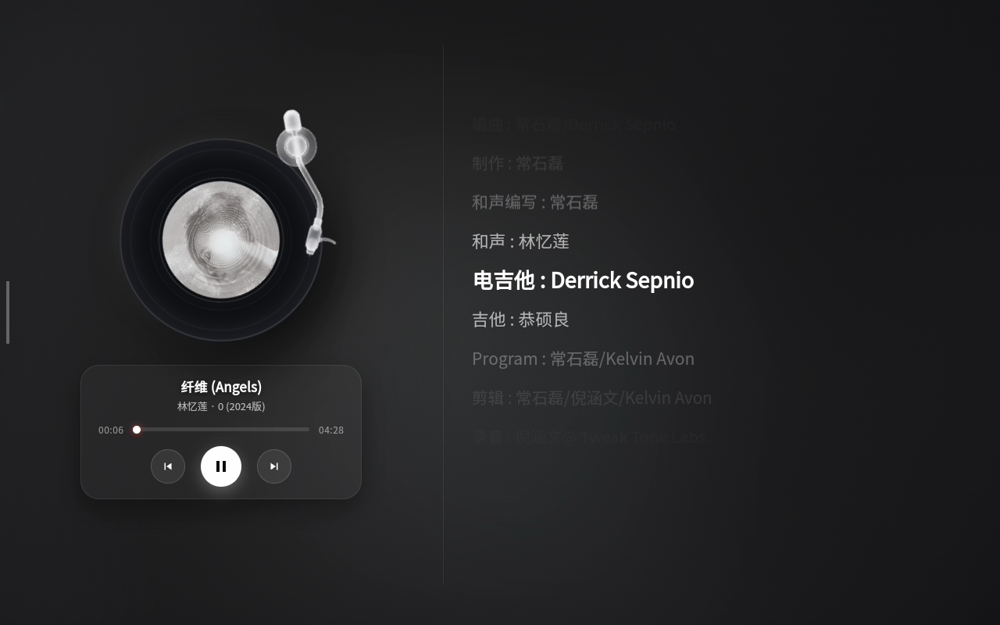
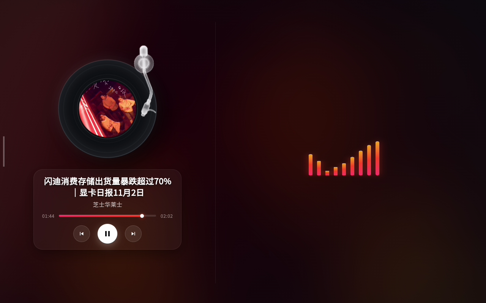

<div align="center">



# Bluetooth Music Canvas (蓝牙音乐看板)

> **极简、高颜值的 Android 蓝牙音频大屏看板 & 桌面黑胶悬浮球**  
> 手机蓝牙连上大屏设备放歌，电视 / 车机 / 智慧屏秒变现代拟物黑胶唱机与双语流光歌词幕布。

[](https://github.com/Arrow36/Bluetooth-Music-Canvas/releases/latest)
[-22c55e.svg)](https://developer.android.com)
[](https://github.com/Arrow36/Bluetooth-Music-Canvas/releases/latest/download/BluetoothMusicCanvas.apk)
[](LICENSE)

[🌐 在线宣传页](https://arrow36.github.io/Bluetooth-Music-Canvas/) · [⬇️ 下载最新版 APK](https://github.com/Arrow36/Bluetooth-Music-Canvas/releases/latest/download/BluetoothMusicCanvas.apk) · [📦 Releases](https://github.com/Arrow36/Bluetooth-Music-Canvas/releases) · [📝 更新记录](CHANGELOG.md)

</div>

---

## 🌟 v1.2.0 更新亮点

- **三大国内源全面支持双语 / 罗马音歌词**：网易云音乐（`tlyric` / `romalrc`）、QQ 音乐（升级 `musicu.fcg` 提取完整中文译文）、酷狗音乐（解密 `KRC` 逐字歌词内嵌译文与罗马音）接入双语对齐与菜单一键开关。
- **超长歌词平衡断句与译文协同排版**：优先按标点、括号与语种边界均分折行；多子句译文按权重匹配拆分行，不可拆单句在开启翻译时聚合为整句双语块并自动换行，杜绝截断。
- **多源容灾与曲目解析修复**：接入 `LRCLIB` 全球同步歌词、`Apple iTunes`（HK / Global）封面兜底与 `120s` 限流熔断冷却；修复歌名括号内含斜杠导致误拆分问题。
- **视觉升级与工程模块化**：默认全局开启磨砂毛玻璃；前端拆分为模块化 `frontend/` 目录自动打包，APK 构建集成签名与 4 字节 ZIP 对齐校验；详细记录见 [CHANGELOG.md](CHANGELOG.md)。

---

## ✨ 核心特性

### 1. 💿 拟物毛玻璃黑胶唱机与零着色器预烘焙背景
- **真实物理循迹**：3D 白透磨砂唱针随播放进度从外圈向内圈游走，暂停自动复位并内置 `1.5s` 防抖锁；专辑封面与旋转黑胶采用分层合成架构（`isolation: isolate`），转动丝滑。
- **全局毛玻璃 + `<canvas>` 离屏预烘焙**：全局默认开启 `backdrop-filter` 磨砂玻璃（隐藏态与沉浸模式自动卸载）；切歌时一次性完成 `16×16 ➔ 64×64` 流体背景模糊预烘焙（`< 0.5ms`），播放期背景模糊 GPU 负载降为 0。

### 2. 🎤 四源双语同步歌词 & 智能分句排版
- **多源一键切换 & 双语翻译开关**：支持「自动推荐」、「网易云音乐」、「QQ音乐」、「酷狗音乐」、「LRCLIB 全球库」、「蓝牙实时歌词」与「律动氛围」，切歌保持用户偏好；菜单内可一键开关 **「双语翻译」**。
- **长句均分与中文译文协同**：平衡计算各行视觉宽度避开单词截断与孤立标点，支持中文多子句按权重拆分高亮、单句译文整块居中对照以及超长译文自动换行。
- **车载蓝牙歌词流 + 双层时间窗口校准**：原生解析网易云 / QQ 音乐蓝牙滚动歌词而不触发假切歌；$\pm 15\text{s}$ 优先窗口防副歌跨段跳转，过滤片头演职员行并内置 `2.5s` 防倒跳锁。

### 3. 📊 1024 点物理频谱 & 智能视频分流
- **9 频段 / 5 频段 AGC 动态音浪**：依据真实采样率将 `20Hz ~ 16kHz` 划分为 9 个物理频段并搭载自适应增益（AGC），即使系统音量调至极低甚至静音仍可全幅律动。
- **按需跨桥门控 & `MediaClassifier` 分流**：正常滚动歌词期间自动暂停 `25Hz` 跨桥频谱推送释放 CPU；单一权威分类器识别 B 站/视频音轨或纯音乐，自动切入大号律动氛围模式。

### 4. 🎧 真硬件蓝牙 A2DP 编码透视
- 底层探测设备真实蓝牙音频编码（`SBC` / `AAC` / `aptX` / `aptX HD` / `LDAC`）、采样率（`44.1kHz` / `48.0kHz`）、位深与声道状态；`MediaMonitorService` 对无 `DUMP` 权限设备实施一次探测门控与超时保护，杜绝重复拉起 `dumpsys` 子进程。

### 5. 🎮 电视遥控器与触控双栖交互 & 桌面悬浮球
- 完整支持红外 / 蓝牙遥控器方向键、确认键、菜单键与返回键导航，并可拖拽预览歌词及 14px~52px 逐像素微调字号。
- 退回后台常驻可拖拽迷你旋转黑胶悬浮球（位置记忆 + 封面 Bitmap 懒加载），同时调用 `WebView.onPause()` 将后台渲染 CPU 降至 `0%`。

### 6. 📺 跨设备广谱硬件适配
- 自动适配紧凑型带屏音箱（`800×480` / `1024×600`）、`720p/1080p/4K` 智慧屏电视、车机横屏以及竖屏副屏（`max-aspect-ratio: 6/5`），兼容主流厂商定制蓝牙协议栈。

---

## 📸 实机预览

<div align="center">
  
  <p><i>音乐模式：拟物毛玻璃黑胶循迹唱机 + 磨砂控制卡 + 450ms 预读平滑高亮歌词</i></p>
  <br/>
  
  <p><i>视频 / 纯音乐模式：MediaClassifier 智能分流 + 9 频段 AGC 动态律动音浪</i></p>
</div>

---

## 📦 安装与快速开始

从 [GitHub Releases](https://github.com/Arrow36/Bluetooth-Music-Canvas/releases/latest) 下载最新版 **`BluetoothMusicCanvas.apk`**（仓库根目录亦同步保留 [`BluetoothMusicCanvas.apk`](BluetoothMusicCanvas.apk)）。

### 方式一：常规安装（推荐）
1. 通过 U 盘、本地文件管理器或 `adb install -r BluetoothMusicCanvas.apk` 安装到 Android 5.0+ 大屏/电视设备。
2. 启动后按顶部引导卡片授予 **「通知使用权」**（用于接收蓝牙 `MediaSession` 歌名与进度）；如需频谱律动或桌面悬浮球，在界面提示时授权录音与悬浮窗权限即可。
3. 手机蓝牙连接设备并开始播放音乐，大屏看板即刻同步黑胶与双语歌词。

### 方式二：ADB 一键安装与完整授权
```bash
# 安装最新构建 APK
adb install -r BluetoothMusicCanvas.apk

# 1. 媒体会话监听权限（必需）
adb shell cmd notification allow_listener com.bluetoothmusiccanvas/com.bluetoothmusiccanvas.MediaMonitorService

# 2. 音频频谱采样权限（律动音浪需要）
adb shell pm grant com.bluetoothmusiccanvas android.permission.RECORD_AUDIO

# 3. 悬浮窗权限（桌面迷你黑胶球需要）
adb shell appops set com.bluetoothmusiccanvas SYSTEM_ALERT_WINDOW allow

# 4. 电池优化白名单（防止息屏/后台被系统回收）
adb shell cmd deviceidle whitelist +com.bluetoothmusiccanvas
adb shell appops set com.bluetoothmusiccanvas RUN_IN_BACKGROUND allow
```

<details>
<summary>可选高级授权：ADB 授予 <code>DUMP</code> 权限（底层编码探测增强 & 实验性蓝牙音量回跳修正）</summary>

在需要读取系统 `bluetooth_manager` / `audio` 服务详情，或启用**实验性蓝牙音量回跳修正**的设备上，可通过 ADB 额外授予：

```bash
adb shell pm grant com.bluetoothmusiccanvas android.permission.DUMP
```

授予后需重启应用生效（`build.py --install` 会自动尝试授予）。未授权时应用会自动跳过相关 `dumpsys` 调用，不影响常规音乐展示与播放控制。蓝牙音量回跳修正依赖厂商 AudioService 日志格式，目前主要在小米/创维部分 Android 9 电视实机验证。

</details>

---

## 🎮 遥控器与触控操作速查

| 状态 | 遥控器按键 | 触控 / 鼠标操作 | 功能说明 |
| :--- | :--- | :--- | :--- |
| **常规播放** | `确定 / OK` | 点击画面中央 / 播控按钮 | 沉浸态先唤醒四周控件；亮屏态控制播放/暂停 |
| **常规播放** | `上 / 下方向键` | 歌词区域上下拖拽 | 浏览上下文歌词，停止操作 3 秒后平滑回滚 |
| **常规播放** | `左 / 右方向键` | 点击上一曲 / 下一曲按钮 | 切换上一首 / 下一首曲目 |
| **任意状态** | `菜单键 (Menu)` / 键盘 `M` | 点击右上角来源状态胶囊 | 展开 / 收起「歌词源切换 + 双语翻译 + 字号调节」菜单 |
| **菜单展开** | `上 / 下` + `确定` | 直接点击菜单条目 | 切换 6 大词源 / 律动模式或开关「双语翻译」 |
| **菜单展开** | `左 / 右方向键` | 点击字体大小 `-` / `+` 按钮 | 按 1px 步进微调歌词字号（`14px ~ 52px`） |
| **退出/重启** | `返回键 (Back)` | 点击 / 长按右上角 `×` 按钮 | 优先关闭二级菜单；短按退至桌面悬浮球，长按 `×` 3 秒重启应用 |

---

## 🛠️ 自主构建、测试与部署

内置纯 Python 跨平台构建器 [`build.py`](build.py) 与自动化测试套件 [`tests/run_all.py`](tests/run_all.py)，无需 Android Studio，仅需 JDK（8 / 11 / 17）与轻量 CLI 工具（`aapt2`、`android.jar`、`d8/r8`）：

```bash
# 1. 仅重新打包模块化前端 -> assets/index.html
python build.py --bundle-only

# 2. 编译、签名与 4 字节对齐输出 BluetoothMusicCanvas.apk（约 3~5 秒）
python build.py

# 3. 运行全量 JS (JSDOM) + Java 回归测试，全部通过后构建 APK
python build.py --test

# 4. 测试通过后构建、通过 ADB 覆盖安装到实机、授权并拉起主界面
python build.py --test --install 192.168.5.18:5555 --launch

# 5. 单独执行前后端自动化测试
python tests/run_all.py
```

---

## 🏗️ 项目架构与数据来源

```text
Bluetooth-Music-Canvas/
├── frontend/                   # 模块化前端源码（template.html / styles/*.css / js/*.js）
├── assets/index.html           # 由 build.py 自动打包生成的运行时 WebView 页面
├── src/com/bluetoothmusiccanvas/
│   ├── MediaMonitorService.java    # 蓝牙 MediaSession 监听、硬件音频探测与桌面悬浮窗
│   ├── MediaStateStore.java        # PlaybackGeneration 代次与切歌竞态隔离状态机
│   ├── MetadataNormalizer.java     # 歌名/歌手规范化、括弧斜杠保护与车载歌词流剥离
│   ├── MediaClassifier.java        # 视频与正规音乐单一权威分类器
│   ├── MetadataFetcher.java        # 四源双语歌词 + iTunes 封面 + 120s 熔断 + 50 首 LRU/负缓存
│   ├── AudioVisualizerHelper.java  # 1024 点 FFT 9 频段频谱与按需跨桥门控
│   ├── BluetoothVolumeSync.java    # 实验性蓝牙音量回跳检测与恢复
│   ├── WebAppInterface.java        # JS <-> Java 跨桥接口
│   └── MainActivity.java           # 全屏硬件加速 WebView 与遥控器按键分发
├── tests/                      # Node.js (Phase 1 & 2) + Java 状态/分类/缓存/KRC 测试套件
├── docs/                       # GitHub Pages 宣传网站源码（docs/index.html & docs/images/）
└── build.py                    # 模块化前端打包 + aapt2 + javac + D8 + 签名 + zipalign 流水线
```

<details>
<summary>歌词与封面接口合规说明</summary>

- **公开标准接口**：`LRCLIB`（同步/纯文本歌词检索）、`Apple iTunes Search API`（仅专辑封面兜底，Apple 未提供免鉴权的官方歌词正文接口）以及 Android 系统 `MediaSession / AVRCP`（蓝牙实时歌词与播放状态）。
- **公开网页/客户端接口**：`网易云音乐`、`QQ音乐`（`musicu.fcg` / `fcg_query_lyric_new.fcg`）、`酷狗音乐`（`mobilecdn` / `krcs.kugou.com`）用于个人开源展示与歌词对齐学习研究；代码中内置单曲查询次数上限、负缓存与 120s 限流冷却机制，遇风控自动优雅降级。

</details>

---

## 📜 项目背景与开源协议

- 项目早期探索源于 [tianyi-c10h-skyworth-SK-L1001-mod](https://github.com/Arrow36/tianyi-c10h-skyworth-SK-L1001-mod)，现已演进为独立的通用 Android 大屏蓝牙音乐看板开源项目。
- 本项目基于 [MIT License](LICENSE) 开源，欢迎提交 Issue 与 Pull Request。
