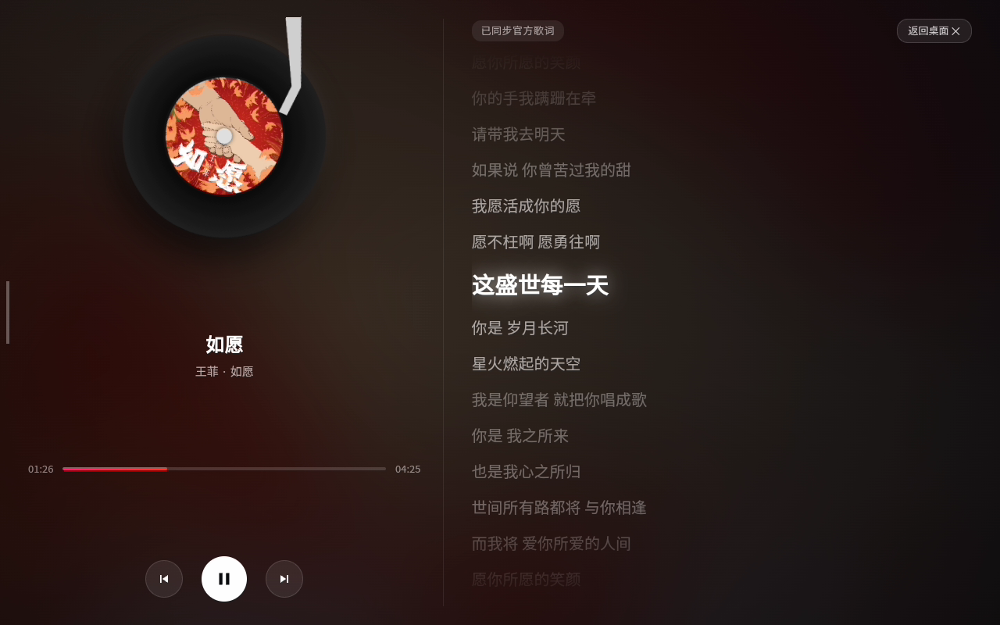
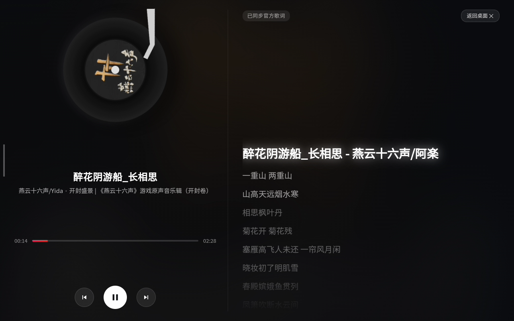

# 🎵 Bluetooth Music Canvas (蓝牙音乐看板)

> **极简、高颜值的 Android 蓝牙音频大屏看板 & 桌面黑胶悬浮球。**  
> 手机连上蓝牙放歌，电视 / 车机 / 智慧屏秒变黑胶唱片大屏与全屏流光歌词幕布。

---

## 🌟 核心特性 (Features)

- 📻 **蓝牙即连即播 (A2DP / AVRCP 监听)**：手机蓝牙连接大屏设备后，播放任意音乐自动唤醒大屏看板；停止播放后自动静默退出，无需手动开闭。
- 💿 **3D 拟物黑胶唱机与唱针 (Vinyl Turntable)**：精细绘制的复古黑胶纹理，播放时随节奏平滑旋转，唱针自动归位起落。
- 🖼️ **多源官方超清封面匹配 (HD Cover Art)**：原生 Java 多级聚合检索（Apple iTunes 600×600 超清原画 + 酷狗官方库），无惧反爬与跨域防盗链。
- 🎤 **毫秒级逐行滚动高亮歌词 (Synced Scrolling Lyrics)**：内置 LRCLIB 与酷狗歌词库，自动同步时间轴滚屏高亮；完美兼容车载蓝牙歌词模式（AVRCP Stream Lyrics）。
- 🌌 **动态流光氛围背景 (Ambient Glow Backdrop)**：全屏背景根据当前播放专辑封面的主色调实时提取流光散景与渐变，质感拉满。
- 🎈 **桌面迷你旋转黑胶悬浮球 (Mini Floating Vinyl Widget)**：退居后台时，在桌面常驻平滑旋转的迷你黑胶悬浮球，支持任意拖拽位置，轻触立即无缝恢复全屏大屏。
- 🚀 **极度轻量与高兼容性 (Pure Java & WebView)**：无 NDK / `.so` 本地库依赖，占用内存 < 30MB，完美兼容 Android 5.0 ~ 14（32 位 / 64 位全架构）。

---

## 📸 实机展示 (Screenshots)

### 1. 播放大屏看板（官方封面 + 毫秒级逐行歌词）


### 2. 多语言与国风歌曲自适应


---

## 📦 安装与快速开始 (Quick Start)

可以直接下载仓库根目录提供的已签名正式版本 `BluetoothMusicCanvas.apk`，通过 ADB 或 U 盘安装到您的安卓电视盒、智慧屏或车机设备。

### 1. 安装 APK
```bash
adb install -r BluetoothMusicCanvas.apk
```

### 2. 授予必要系统权限 (仅需一次)
由于本应用需要监听系统底层媒体流控制器并在后台/开机自启显示悬浮窗，需要授予相应权限：

```bash
# 1. 授予媒体会话监听权限 (Notification Listener)
adb shell cmd notification allow_listener com.bluetoothmusiccanvas/com.bluetoothmusiccanvas.MediaMonitorService

# 2. 授予悬浮窗权限 (System Alert Window)
adb shell appops set com.bluetoothmusiccanvas SYSTEM_ALERT_WINDOW allow

# 3. 授予后台运行与电池白名单 (防止被系统休眠清理)
adb shell cmd deviceidle whitelist +com.bluetoothmusiccanvas
adb shell appops set com.bluetoothmusiccanvas RUN_IN_BACKGROUND allow
```

### 3. 开始使用
* 手机蓝牙配对连接电视/大屏。
* 在手机任意音乐软件（Apple Music、网易云、QQ 音乐、酷狗、Spotify 等）播放音乐。
* 大屏立即自动亮屏弹出全屏黑胶流光看板！

---

## 🛠️ 自主构建工程 (Zero-Dependency Build)

本项目内置完全独立的跨平台自动化构建流水线 [`build.py`](build.py)，**无需安装重型 Android Studio**，仅依赖标准 JDK（8+ / 11 / 17）与 Android 构建工具（AAPT2, android.jar, D8）即可完成资源打包、字节码编译与签名：

```bash
# 运行构建流水线
python build.py
```

构建脚本会自动检测系统环境变量（`JAVA_HOME`、`ANDROID_HOME`、`ANDROID_SDK_ROOT` 等）与标准工具路径，并在工程根目录自动生成已签名并对齐的 `BluetoothMusicCanvas.apk`。

---

## 🏗️ 架构说明 (Architecture)

```text
手机 (蓝牙发送端)
       │ (Bluetooth A2DP Audio + AVRCP Metadata)
       ▼
Android 蓝牙协议栈 (com.android.bluetooth)
       │
       ▼ (MediaSessionManager)
MediaMonitorService (com.bluetoothmusiccanvas.MediaMonitorService)
       │
       ├──> MetadataFetcher (Java 多线程聚合检索 iTunes / LRCLIB / Kugou)
       ├──> WindowManager (桌面悬浮迷你旋转黑胶 TYPE_APPLICATION_OVERLAY)
       └──> MainActivity (硬件加速 WebView 纯净全屏容器)
              │
              ▼
       assets/index.html (3D 黑胶动效、流光氛围、毫秒歌词引擎、播控桥接)
```

---

## 📜 项目背景 (Project Background)

本项目的早期开发基于 [天翼 C10H / 创维 SK-L1001 改造项目](https://github.com/Arrow36/tianyi-c10h-skyworth-SK-L1001-mod) 中的相关探索，现已独立为 Bluetooth Music Canvas Android 应用，并进行单独开发和维护。

---

## 📄 开源许可证 (License)

本项目采用 [MIT License](LICENSE) 开源。欢迎提交 PR 与 Issue！
